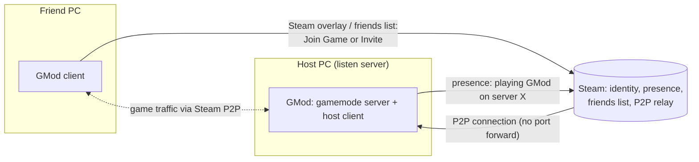
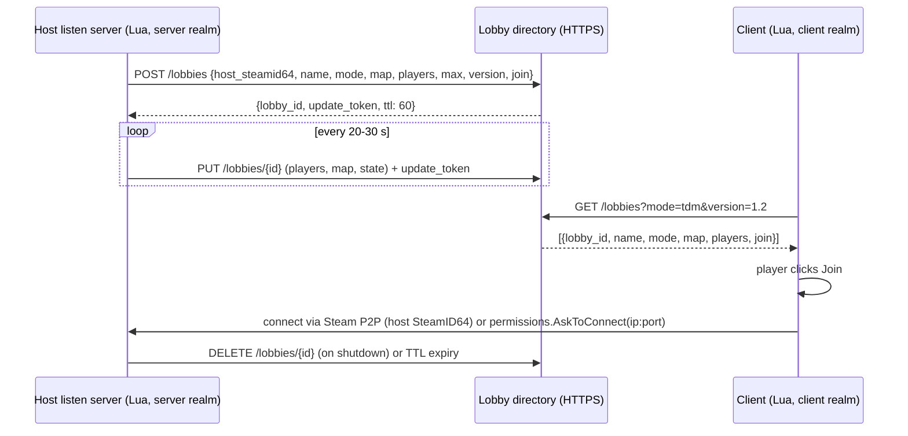

# 02 — Backend and orchestration for a "CoD in GMod" lobby system

Status: research notes, 2026-11-03.

Scope (final, after two scope changes from the user):

- A casual "CoD in GMod" gamemode, "simple and dumb".
- Must work **offline** (solo with bots) and **with friends**.
- Matches are **hosted by players on their own listen servers** (like CoD private matches). No dedicated match-server fleet.
- Anti-cheat and trust against hosts are **not** priorities. Friends trust each other.
- Recommendation order: **zero-backend first**, a tiny optional lobby directory later as a "nice to have". Dedicated-server orchestration (Agones and similar) is only an appendix.

Evidence labels used below:

- **[Doc]** — confirmed in a primary source (URL given).
- **[Repo]** — confirmed from GitHub repository metadata on 2026-11-03 (`gh api repos/...`).
- **[ASSUMPTION]** — not verified here. Most GMod engine/Lua behaviour is being verified by a separate agent (the "GMod Lua API limits" research). Each assumption says who must verify it.

---

## 0. TL;DR

1. **No backend is needed for the MVP.** Steam already provides the three things a backend would do: identity (SteamID), presence ("Friend X is playing GMod"), and joining ("Join Game" from the Steam friends list, via Steam P2P without port forwarding).
2. **Progression lives on each player's own machine** (client-side `sql` / `data/` files) and is sent to the host on join. It is forgeable. That is accepted.
3. **Offline = a local listen server with bots**, not GMod single-player mode (single-player has one slot, so no room for bots) — **[ASSUMPTION, verify]**.
4. **In-game "Friends' lobbies" panel** is the smallest useful UI. Whether Lua can list friends' sessions without a backend is the key open question for the API agent. If it cannot, the panel shows only "Host" / "Invite via Steam overlay" and relies on Steam's own Join Game.
5. **Next step (optional):** a tiny lobby directory. Hosts register over HTTP with a heartbeat; clients browse over HTTP. Store the host **SteamID64** (P2P identity), not an IP. Best fit: **one Cloudflare Worker + one Durable Object (or D1)**, managed with OpenTofu. A self-hosted Go service is the alternative if A2S (UDP) verification is wanted, because Workers cannot send UDP.
6. Nothing a host reports can be verified to a high standard. The backend can do cheap plausibility checks (Steam Web API `GetPlayerSummaries`, A2S query for port-forwarded hosts), plus rate limiting. For a friends-and-casuals project, that is enough.

---

## 1. Assumptions this report relies on

Engine and Lua facts that the design depends on. Items marked [ASSUMPTION] should be confirmed by the API-limits agent before implementation.

| # | Assumption | Status | Source / owner |
| --- | --- | --- | --- |
| A1 | `HTTP()` exists in both client and server realms. Requests to private / loopback addresses are blocked unless the **dedicated** server runs with `-allowlocalhttp`. | [Doc] | <https://wiki.facepunch.com/gmod/Global.HTTP> |
| A2 | A client can be sent to another server only with `permissions.AskToConnect(address)`. It is **client realm only** and shows a confirmation prompt. If no port is given, `:27015` is used. | [Doc] | <https://wiki.facepunch.com/gmod/permissions.AskToConnect> |
| A3 | `GM:CheckPassword(steamID64, ipAddress, svPassword, clPassword, name)` runs on the server for every non-local joining player. Returning `false, "message"` rejects the player. | [Doc] | <https://wiki.facepunch.com/gmod/GM:CheckPassword> |
| A4 | Servers can load binary modules from `garrysmod/lua/bin` (`gmsv_*`). Clients cannot load them from Workshop content; on a listen server, the host's "server" side is the same game process as the host's client, so a host would need to install a module manually. Practical consequence: **do not depend on binary modules** (GWSockets, CHTTP) for player-hosted matches. | [Doc] for server modules (GWSockets README, CHTTP README); [ASSUMPTION] for the listen-server case | <https://github.com/FredyH/GWSockets>, <https://github.com/timschumi/gmod-chttp> |
| A5 | GMod listen servers support Steam P2P: friends can join through the Steam friends list ("Join Game") without port forwarding. | [ASSUMPTION] — only secondary sources found (forum posts, hosting guides). API agent must verify, including the exact convars / menu options (P2P on/off, friends-only). | e.g. <https://steamcommunity.com/app/4000/discussions/1/1742226629861137641> (secondary) |
| A6 | GMod Lua has **no** API for the local player's full Steam friends list or their rich presence. `Player:GetFriendStatus()` works only for players on the same server. | [ASSUMPTION] — API agent to verify. This decides whether a "Friends' lobbies" panel can be built without a backend. | — |
| A7 | GMod single-player is `maxplayers 1`; bots (`player.CreateNextBot`) need free player slots. So "offline with bots" = start a local multiplayer listen server with `maxplayers > 1`, LAN-only / P2P off. | [ASSUMPTION] — API agent to verify. | — |
| A8 | Lua shipped to clients (and all gamemode Lua on the host) is readable and modifiable by the person running it. Any secret embedded in the addon is public. | General property of Workshop addons; not a GMod-specific doc. | — |

---

## 2. Three options for "do we need a backend?"

### 2.1 Option (a): zero-backend (recommended MVP)

Everything goes through Steam and the engine:

Flow:

1. Host opens the gamemode's own menu (or GMod's "Start New Game"), picks mode/map, starts a listen server with P2P enabled (A5).
2. Friends see "Playing Garry's Mod" in the Steam friends list and click **Join Game**, or the host invites them with the Steam overlay (Shift+Tab).
3. On join, the server runs the normal gamemode flow: team pick, loadout, match, scoreboard.
4. "Return to hub" is not needed: after a match, the same listen server starts the next round/map (CoD private match loop).

Pros: zero infra, zero cost, zero ops, nothing to secure. Works offline. Works forever, even if the project is abandoned.

Cons: no in-game browser of "public lobbies"; discovery only among Steam friends (and, if the host chooses, the normal GMod server browser).

### 2.2 Option (b): tiny lobby directory (optional, later)

A small HTTP service where hosts publish "my lobby is open" and clients list open lobbies from an in-game menu.

Design points:

- **Heartbeat + TTL.** A lobby without a heartbeat for ~60 s disappears. Listen servers die without notice (game closed, crash), so TTL is mandatory; explicit `DELETE` is a nice-to-have.
- **`update_token`.** Random token returned at registration; only its holder can update/delete the entry. It does not prove identity, it only stops strangers from editing someone else's listing.
- **Version field.** Clients filter by gamemode version, so players do not join hosts with incompatible Lua.
- **Polling, not websockets.** Built-in `HTTP()` only (A4: no binary modules for player hosts). The client polls `GET /lobbies` every 5–10 s while the browser panel is open. At tens to hundreds of players this is trivially cheap.
- **Join field** — see section 4 (P2P identity vs IP).
- **Privacy.** Listing is opt-in ("Public lobby" checkbox). Default is friends-only (option a).

### 2.3 Option (c): hybrid

Zero-backend for play; the directory only adds discovery. If the directory is down, everything still works through Steam friends. This is the recommended end state: **the directory must never be on the critical path to playing.**

---

## 3. Trust model (short)

The user explicitly accepts forgeable progression. Short version for the record:

1. **Progression is local and forgeable. That is fine.**
   - Each player's unlocks/XP are stored on their own PC (client-realm `sql` or a file in `data/`).
   - On join, the client sends its progression to the host via a net message; the host applies it for the match; at match end, the host sends XP earned back; the client saves it.
   - A player can edit their own file. A host can grant anything. Same as CoD private matches with mods. Accepted.
   - Alternative "per-host progression" (host stores everyone's XP in its server-side DB, keyed by SteamID) is worse for the user: progress would not follow a player between hosts.
2. **Why central, trustworthy progression is impossible here** (one paragraph, for future reference): the host runs the server Lua and the game process, so the host can forge any result. Signing results does not help: the signing key would have to live in the addon (public, A8) or on the host's machine (controlled by the adversary). Even the identity of the HTTP caller cannot be proven: GMod Lua has no access to Steam auth session tickets **[ASSUMPTION]**, so the backend cannot verify which SteamID sent a request. The only real fix is servers the project operates itself (Appendix A), and even then only for matches on those servers.
3. **What the directory can check cheaply** (abuse, not cheating):
   - **Rate limit** registrations per source IP and per claimed SteamID64 (e.g. ≤ 3 active lobbies per IP, ≤ 1 per SteamID).
   - **Plausibility via Steam Web API**: `ISteamUser/GetPlayerSummaries/v2` returns `gameid` (the app ID if the user is in a game) and `gameserverip` for public profiles. The directory can check "this SteamID is currently playing app 4000". It proves only that the person is in GMod, not that they sent the request, and it fails for private profiles. Sources (secondary; Valve's wiki returned 403 to the fetcher): <https://wiki.teamfortress.com/wiki/WebAPI/GetPlayerSummaries>, <https://developer.valvesoftware.com/wiki/Steam_Web_API>.
   - **A2S_INFO query** (UDP) to `ip:port` for port-forwarded hosts: confirms a Source server is really there and returns its name, map, player count. Reference: <https://developer.valvesoftware.com/wiki/Server_queries>. Requires UDP from the backend (not possible from Cloudflare Workers, see section 6).
   - **Server SteamID lookup**: `ISteamApps/GetServersAtAddress/v1?addr=IP[:queryport]` (no key listed as required) and `IGameServersService/GetServerSteamIDsByIP` (key required) map an address to registered game servers. Source: <https://partner.steamgames.com/doc/webapi/ISteamApps>, <https://partner.steamgames.com/doc/webapi/IGameServersService>. Useful only for hosts visible to the master server.
   - **Text filtering** of lobby names (length limit, a small block list).
   - For a friends-and-casuals project: rate limit + TTL + name length limit is enough. Skip the rest until abuse actually happens.

---

## 4. NAT: P2P identity vs IP:port

| Case | What the directory stores | How the client joins | Host requirements |
| --- | --- | --- | --- |
| Steam P2P works for GMod listen servers (A5) | **Host SteamID64** | Steam P2P connect to the host's SteamID. Exact client-side mechanism from Lua is an **open question for the API agent** (e.g. whether `permissions.AskToConnect` / the `connect` command accept a P2P address form). If Lua cannot start a P2P connect, the panel tells the player to use Steam "Join Game" on that host instead. | None. Works behind NAT and CGNAT (Steam relays traffic). |
| No P2P, or host chooses direct | **Public IP:port** (the directory takes the IP from the TCP connection of the registration request, not from the body) | `permissions.AskToConnect("ip:port")` (A2: shows a prompt) | UDP 27015 forwarded on the router (or UPnP), not behind CGNAT. Many home users cannot do this. Tunnel services (e.g. playit.gg) are a workaround but add friction. |

Recommendation: store **both** fields, prefer P2P. Never let the client body dictate the IP: use the request's source IP, which at least stops someone from listing a third party's address.

---

## 5. MVP and next steps

### MVP (zero-backend, no infra)

1. Gamemode menu: **Play offline** (local listen server, bots fill teams, LAN-only — A7) and **Host match** (listen server, P2P on, friends can join).
2. In-match: CoD-style loop (mode, score limit, next map vote, back to pre-match lobby on the same server).
3. Local progression (client-side storage, synced with the host by net messages).
4. "Invite friends" button that opens the Steam overlay (if Lua can open it — API agent) or tells the player to press Shift+Tab.
5. Hide from the public server browser by default (friends-only P2P, or `sv_lan 1` for offline). The exact convars for GMod P2P / friends-only are for the API agent to confirm.

Cost: $0. Ops: none.

### Step 2 (only if wanted): lobby directory

1. One HTTPS endpoint with four routes: `POST /lobbies`, `PUT /lobbies/{id}`, `DELETE /lobbies/{id}`, `GET /lobbies`.
2. Host registers only when the "Public lobby" checkbox is on.
3. In-game browser panel (polling).
4. Rate limit + TTL + name length limit.

### Step 3 (unlikely to be needed)

Party/presence service (section 7), central stats, or dedicated servers (Appendix A).

---

## 6. Hosting the directory

Load estimate: hundreds of players → at most dozens of lobbies; heartbeats every 30 s → under 5 000 requests/hour plus browser polling. Any option below handles this on a free tier.

### 6.1 Cloudflare Worker + Durable Object (recommended)

- One Worker for the HTTP API. One SQLite-backed **Durable Object** holds all lobbies in memory/SQLite, which gives strict consistency for TTL and per-key counters. Alternative: D1 (SQL) with a `expires_at` column.
- **Free plan limits** [Doc] (<https://developers.cloudflare.com/workers/platform/pricing/>):
  - Workers: 100 000 requests/day, 10 ms CPU per invocation.
  - Durable Objects: free plan available, **SQLite backend only**, 100 000 requests/day, 13 000 GB-s/day.
  - D1: 5 M rows read/day, 100 000 rows written/day, 5 GB.
  - KV: only 1 000 writes/day — **unsuitable for heartbeats**. Do not use KV for lobbies.
  - Paid plan minimum: $5/month.
- **Rate limiting binding** exists, period 10 or 60 s, per Cloudflare location and eventually consistent; Cloudflare recommends a Durable Object for strict global limits [Doc] (<https://developers.cloudflare.com/workers/runtime-apis/bindings/rate-limit/>). For this project the DO already holds the state, so count there.
- **Limitation:** Workers have `connect()` for outbound **TCP** only; the docs describe no UDP [Doc] (<https://developers.cloudflare.com/workers/runtime-apis/tcp-sockets/>). So no A2S verification from a Worker. Steam Web API calls (HTTPS) are fine; keep the Steam Web API key in a Worker secret.
- IaC: OpenTofu Cloudflare provider for the Worker, route, DO binding and secret; code deploy with Wrangler from CI. No server to run. Public reachability and TLS come for free.

### 6.2 Self-hosted Go service

- One Go binary, state in memory (or Redis/Valkey if more than one replica). Runs on any self-hosted machine or VPS; exposed through a reverse proxy, or through a Cloudflare Tunnel so the host's IP is not exposed.
- Pros: can do **A2S UDP queries**; full control.
- Cons: the public game feature depends on the uptime of that machine; the machine is exposed to the internet (mitigated by Cloudflare Tunnel).

### 6.3 Off-the-shelf (Nakama, Open Match) — not recommended

- **Nakama** (heroiclabs/nakama, Apache-2.0, v3.41.0 released 2026-09-18 [Repo]): full social/matchmaking backend (accounts, friends, parties, matchmaker, storage). Needs PostgreSQL/CockroachDB. Its client SDKs do not include GLua; the REST API could be called with `HTTP()`, but auth again cannot be Steam-verified from Lua (section 3). Far too much for this scope.
- **Open Match** (googleforgames/open-match, latest release v1.8.1 from 2023-12 [Repo]) and **Open Match 2** (googleforgames/open-match2, no releases, active repo [Repo]): ticket-based matchmaking framework for dedicated-server games on Kubernetes. Solves skill-based matchmaking at scale, which this project does not need.

---

## 7. Parties and cross-server presence

- **Zero-backend answer:** Steam already is the party and presence service. Players form a "party" by joining the same host. Invites use the Steam overlay. This covers "friends on different servers" too: a friend on another GMod server can see the host in their Steam friends list and click Join Game.
- **Party follows the host:** if the host changes map/mode, everyone stays on the same listen server; no transfer needed.
- **A real party service** (party IDs, "follow leader" across servers) would need a backend that knows which players are together. Without verified identity (section 3) a malicious user could fake party membership, but for friends this does not matter. Implementation if ever needed: the directory gets `POST /parties`, `POST /parties/{id}/join`, and the party leader's client polls; when the leader joins a lobby, members' clients receive the join target on their next poll and call `permissions.AskToConnect` (prompt shown, A2). Not recommended before the directory proves useful.

---

## 8. Server browser visibility

- **Offline mode:** LAN-only (`sv_lan 1`) so the local server is not registered with the Steam master server and only LAN clients can join. Reference: <https://developer.valvesoftware.com/wiki/Sv_lan> (page returned 403 to the fetcher; behaviour is standard Source engine knowledge — **[ASSUMPTION, low risk]**).
- **Friends-only hosted match:** use GMod's P2P / friends-only option (exact convars are for the API agent, A5).
- **Public hosted match:** normal listen server, appears in the GMod server browser under its gamemode; the optional directory adds a nicer in-game list on top.
- `sv_visiblemaxplayers` and hostname tricks are only relevant to dedicated servers (Appendix A).

---

## 9. Costs and risks

| Variant | Money | Ops effort | Main risks |
| --- | --- | --- | --- |
| MVP zero-backend | $0 | None | Depends on GMod P2P working reliably (A5). Discovery limited to Steam friends. |
| + Cloudflare directory | $0 (free tier), $5/month if limits are exceeded | Very low (one Worker, OpenTofu + Wrangler) | Fake/spam lobbies (mitigated by rate limit + TTL); directory abuse is cosmetic only, since playing never depends on it. |
| + Self-hosted Go directory | Cost of the host machine | Low (one service) | Host uptime becomes a public dependency; exposure of the host (use Cloudflare Tunnel). |
| Dedicated servers (Appendix A) | Real compute + bandwidth; ~1 GMod server process per match | High | Everything in Appendix A. Not justified for this scope. |

---

## Appendix A — If we ever go dedicated (short)

Kept only for reference. Verified facts:

1. **Agones** (now at `agones-dev/agones`, v1.61.0 released 2026-09-24, Apache-2.0 [Repo]).
   - Objects: `GameServer`, `Fleet` (warm pool of Ready servers), `GameServerAllocation` (atomically picks a Ready server and marks it Allocated).
   - **No Lua SDK**, but there is a **REST SDK** served by the sidecar at `http://localhost:${AGONES_SDK_HTTP_PORT}/` (default HTTP port **9358**, gRPC 9357): `POST /ready`, `POST /health`, `POST /allocate`, `POST /shutdown`, `POST /reserve`, `GET /gameserver`, `GET /watch/gameserver`, `PUT /metadata/label`, `PUT /metadata/annotation`, plus counters/lists under `/v1beta1/` [Doc] (<https://agones.dev/site/docs/guides/client-sdks/rest/>, <https://agones.dev/site/docs/guides/client-sdks/>).
   - **GMod blocks HTTP to 127.0.0.1 unless the dedicated server runs with `-allowlocalhttp`** [Doc] (A1). So srcds must be started with `-allowlocalhttp` to call the sidecar from Lua's `HTTP()`. (CHTTP is a libcurl drop-in that might avoid the restriction; its README does not say — unverified.)
   - Health: if `Health()` is not called at least every `periodSeconds` (default 5 s) with `failureThreshold` 3, the server is marked Unhealthy [Doc] (<https://agones.dev/site/docs/reference/gameserver/>). A Lua `timer.Create` calling `POST /health` every 2 s covers this; note that a hibernating empty srcds may stop running timers (CHTTP README mentions timers that work while a server hibernates).
   - Ports: `portPolicy` `Dynamic` (default), `Static`, `Passthrough` (containerPort = chosen hostPort; read the port from the SDK), `None`; default dynamic range **7000–8000** (`gameservers.minPort` / `maxPort`) [Doc] (<https://agones.dev/site/docs/installation/install-agones/helm/>). srcds binds to `-port N`, so either use `Passthrough` with a wrapper script that reads the port before launching srcds, or `Dynamic` with a fixed containerPort 27015.
   - `Shutdown()` terminates the pod; a new one is created by the Fleet — this is the "recycle after match" step.
   - Allocator service defaults to mTLS on a LoadBalancer service (port 443) [Doc].
2. **Simpler alternatives:** a static pool of N srcds systemd units or N pods with `hostNetwork`, each with a fixed port; a tiny service hands them out. **Pterodactyl** (pterodactyl/panel v1.15.2, 2026-10 [Repo]) and **LinuxGSM** (v26.4.0, 2026-10 [Repo]) manage GMod servers but are panels, not allocators. **Nomad** works with raw_exec/docker and static ports.
3. **Container image:** `ceifa/garrysmod` (repo `ceifa/garrysmod-docker`, MIT, Debian-based, not Bitnami, env-var config for workshop collection, gamemode, map, maxplayers; ~4.4 GB compressed) — <https://github.com/ceifa/garrysmod-docker>, <https://hub.docker.com/r/ceifa/garrysmod/tags>. Large image → pre-pull on nodes; Workshop content (`+host_workshop_collection`) should be baked into the image or a cached volume, otherwise each cold start downloads it.
4. **Trust on dedicated servers:** the backend trusts only its own servers (per-server secret in a Kubernetes Secret). Reserved players enforced with `GM:CheckPassword` against a SteamID64 allowlist fetched from the backend (A3), with an expiry; no-shows are released after a timeout.

---

## Sources

- GMod wiki: <https://wiki.facepunch.com/gmod/Global.HTTP>, <https://wiki.facepunch.com/gmod/permissions.AskToConnect>, <https://wiki.facepunch.com/gmod/GM:CheckPassword>
- GWSockets: <https://github.com/FredyH/GWSockets>; CHTTP: <https://github.com/timschumi/gmod-chttp>
- Steam Web API: <https://partner.steamgames.com/doc/webapi/ISteamApps>, <https://partner.steamgames.com/doc/webapi/IGameServersService>, <https://wiki.teamfortress.com/wiki/WebAPI/GetPlayerSummaries>, <https://developer.valvesoftware.com/wiki/Server_queries>
- Cloudflare: <https://developers.cloudflare.com/workers/platform/pricing/>, <https://developers.cloudflare.com/workers/runtime-apis/bindings/rate-limit/>, <https://developers.cloudflare.com/workers/runtime-apis/tcp-sockets/>
- Agones: <https://agones.dev/site/docs/guides/client-sdks/rest/>, <https://agones.dev/site/docs/guides/client-sdks/>, <https://agones.dev/site/docs/reference/gameserver/>, <https://agones.dev/site/docs/installation/install-agones/helm/>
- Nakama: <https://github.com/heroiclabs/nakama>; Open Match: <https://github.com/googleforgames/open-match>, <https://github.com/googleforgames/open-match2>
- GMod Docker: <https://github.com/ceifa/garrysmod-docker>
- P2P listen servers (secondary only): <https://steamcommunity.com/app/4000/discussions/1/1742226629861137641>
